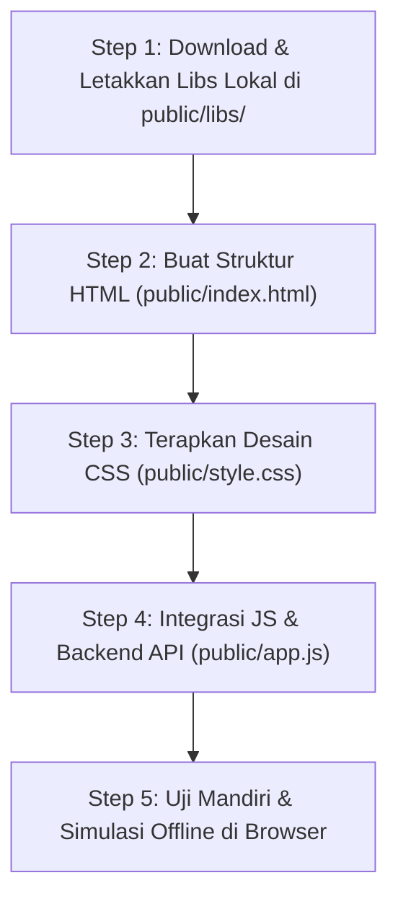

# Panduan & Brief Kerja Frontend (`public/` — SK-4 Jesika)

Dokumen ini disusun khusus sebagai panduan langkah demi langkah bagi **Jesika (SK-4)** untuk membangun antarmuka WebGIS interaktif **`ptk-studyhub-gis` (Pontianak Kota Literasi)** dari awal hingga siap diintegrasikan dengan Backend.

---

## 🎯 1. Peran & Tanggung Jawab Utama (SK-4)

Sebagai pengembang frontend, tugasmu adalah:
1. Membangun antarmuka modern bergaya **Bento Floating UI** yang melayang rapi di atas peta Leaflet.
2. Menerapkan arsitektur **Zero-CDN Offline-First** (seluruh pustaka CSS, JS, icon, dan font wajib lokal, tanpa link internet `https://...`).
3. Mengatur **State Management terpusat** (`state` $\rightarrow$ `renderBelajar()`) agar filter, pencarian, dan cluster selalu sinkron.
4. Menghubungkan antarmuka ke **REST API Backend** (`server.js`) yang sudah siap dan teruji.

---

## 📚 2. Urutan Membaca Dokumen Acuan (Wajib!)

Sebelum menulis kode, luangkan waktu membaca dokumen berikut secara berurutan:

1. **[docs/prd.md](file:///home/rafli/Programming/projects/ptk-studyhub-gis/docs/prd.md)**  
   *Fokus:* Bagian 3.C (Frontend WebGIS) dan Kriteria Penerimaan (Acceptance Criteria). Pahami fitur apa saja yang harus tersedia di antarmuka.
2. **[docs/design.md](file:///home/rafli/Programming/projects/ptk-studyhub-gis/docs/design.md)**  
   *Fokus:* Desain sistem, palet warna *Sage & Orange* (`#5B6E2C` Olive, `#7D8D39` Moss, `#FF5A22` Signal Orange), hierarki font, dan layout *Bento Floating Cards*.
3. **[docs/api-contract.md](file:///home/rafli/Programming/projects/ptk-studyhub-gis/docs/api-contract.md)**  
   *Fokus:* Bentuk data JSON yang dikembalikan backend (`/api/data/:layer`, `/api/stats/jenis`) dan format payload saat mengirim poligon baru (`/api/feature/zona`).
4. **[AGENTS.md](file:///home/rafli/Programming/projects/ptk-studyhub-gis/AGENTS.md)**  
   *Fokus:* Guardrails teknis (aturan larangan CDN, struktur `state` wajib di `app.js`, dan ketentuan `renderBelajar()`).

---

## 🎨 3. Menghubungkan & Memeriksa Desain di Figma

Desain UI telah dimodelkan secara detail di Figma Desktop.

- **File Key Figma:** `0k5P4h8J46vbsf77QANP8U`
- **Section Desain:** `WebGIS UI`
- **Frame Utama yang Perlu Diinspeksi:**
  1. `Desktop 1440 default`: Tampilan desktop utama (Bento kiri untuk statistik, Bento kanan untuk kontrol filter & daftar lokasi, bar bawah untuk layer switcher).
  2. `Mobile 390 default`: Tampilan responsif layar kecil (header ringkas, bottom sheet 45vh, FAB bulat `+` untuk tambah zona).
  3. `Modal tambah zona`: Tampilan pop-up modal saat selesai menggambar poligon zona belajar baru.
  4. `State loading & error`: Tampilan spinner loading dan pesan kesalahan jika API gagal diambil.
  5. `Catatan desain`: Alasan pemilihan warna, kontras WCAG AA, dan aturan tipografi.

> 💡 **Jika kamu menggunakan AI Agent / MCP Figma Console:**  
> Pastikan aplikasi Figma Desktop terbuka dengan plugin MCP aktif di port `9224` (atau `9223`). Agent dapat membaca dimensi, warna, padding, dan struktur node langsung dari Figma canvas.

---

## 🛠️ 4. Langkah Pengerjaan Bertahap (Step-by-Step)



---

### Step 1: Penyiapan Library Lokal di `public/libs/` (Zero-CDN)

Karena aplikasi harus bisa dijalankan di laboratorium **tanpa koneksi internet**, dilarang memuat script/style dari `unpkg.com`, `cdnjs`, atau `cdn.jsdelivr.net`.

Simpan file-file berikut secara lokal di direktori `public/libs/`:
- **Leaflet JS & CSS (v1.9.x):**
  - `public/libs/leaflet/leaflet.js`
  - `public/libs/leaflet/leaflet.css`
  - `public/libs/leaflet/images/` (`marker-icon.png`, `marker-shadow.png`, dll.)
- **Leaflet.markercluster:**
  - `public/libs/leaflet.markercluster/leaflet.markercluster.js`
  - `public/libs/leaflet.markercluster/MarkerCluster.css`
  - `public/libs/leaflet.markercluster/MarkerCluster.Default.css`
- **Leaflet.draw:**
  - `public/libs/leaflet-draw/leaflet.draw.js`
  - `public/libs/leaflet-draw/leaflet.draw.css`
  - `public/libs/leaflet-draw/images/`

---

### Step 2: Struktur HTML (`public/index.html`)

Susun kerangka DOM di `public/index.html` dengan pembagian layout:

1. **Kanvas Peta Penuh:** `<div id="map"></div>` (`100vw x 100vh`).
2. **Bento Kiri (`.bento-left`):**
   - Konteks kecil: `"PjBL SIG Dasar, Kelompok 3"`
   - Judul: `"Pontianak Kota Literasi"`
   - Angka statistik besar (`54px` bold) untuk total lokasi.
   - Indikator lokasi gratis & stacked bar rasio kategori 3 warna.
   - Rincian jumlah per kategori (`Perpustakaan`, `Taman Baca`, `Co-working Space`).
   - Sumber data: `"GET /api/stats/jenis"`.
3. **Bento Kanan (`.bento-right`):**
   - Input pencarian tempat belajar (`#search-input`).
   - Chips filter kategori (`#chip-perpustakaan`, `#chip-baca`, `#chip-coworking`).
   - Toggle switches:
     - `Hanya Gratis` (`#toggle-gratis`)
     - `Mode Cluster` (`#toggle-cluster`)
     - `Label Kapasitas > 50` (`#toggle-labels`)
   - Header daftar lokasi + counter dinamis (misal: `"30 dari 30"`).
   - Kontainer daftar lokasi (`#location-list`) dengan *hairline divider*.
   - Tombol aksi di bawah panel: `+ Tambah Zona` (primary) dan `Reset Peta` (secondary).
4. **Bento Bar Bawah (`.bento-bottom-bar`):**
   - Kapsul *layer switcher*: `Zona Belajar`, `Batas Kelurahan`, `Sekolah & Kampus`.
5. **Modal Tambah Zona (`#modal-zona`):**
   - Formulir input atribut poligon baru: `Nama Zona`, `Keterangan`, ringkasan koordinat, tombol `Simpan Zona` dan `Batal`.

---

### Step 3: Desain Vanilla CSS (`public/style.css`)

Terapkan styling murni mengacu pada [docs/design.md](file:///home/rafli/Programming/projects/ptk-studyhub-gis/docs/design.md):
- **Font Stack:** Gunakan system font stack: `system-ui, -apple-system, BlinkMacSystemFont, 'Segoe UI', Roboto, sans-serif`.
- **Warna Identitas:**
  - Latar kanvas peta fallback: `#F3F6F4`
  - Batas kelurahan (offline basemap): Fill `#FFFFFF`, Stroke `#D8DED4` (1px)
  - Perpustakaan: `#5B6E2C` (Olive)
  - Taman Baca: `#7D8D39` (Moss)
  - Co-working: `#FF5A22` (Signal Orange)
  - Poligon Zona: Fill `rgba(91, 110, 44, 0.14)`, Stroke `#5B6E2C` (2px dashed)
- **Border Radius:** Kartu bento `16px`, input/tombol `10px`, pill hanya untuk chips & kapsul layer switcher.

---

### Step 4: Logika JavaScript & Koneksi API (`public/app.js`)

#### A. Wajib Gunakan Objek `state` Terpusat (Single Source of Truth)

Setiap event listener (klik filter, toggle, ketik pencarian) **DILARANG** langsung mengubah layer peta. Wajib memperbarui objek `state`, lalu memanggil `renderBelajar()`:

```javascript
// Struktur state baku
const state = {
  filters: {
    perpustakaan: true,
    baca: true,
    coworking: true
  },
  cluster: false,
  showGratis: false,
  showLabels: true,
  kecamatan: 'all',
  searchQuery: ''
};
```

#### B. Loading Data Awal secara Paralel (`Promise.all`)

Saat halaman pertama kali dibuka, panggil endpoint backend secara paralel:

```javascript
async function initApp() {
  try {
    showLoading();
    const [resBelajar, resZona, resKelurahan, resStats] = await Promise.all([
      fetch('/api/data/belajar').then(r => r.json()),
      fetch('/api/data/zona').then(r => r.json()),
      fetch('/api/data/kelurahan').then(r => r.json()),
      fetch('/api/stats/jenis').then(r => r.json())
    ]);

    // Simpan data mentah ke variabel modul
    dataBelajar = resBelajar;
    dataZona = resZona;
    dataKelurahan = resKelurahan;

    // Render statistik di Bento Kiri
    renderStats(resStats);

    // Render layer basemap kelurahan & zona poligon
    renderBasemap(dataKelurahan);
    renderZona(dataZona);

    // Render titik tempat belajar berdasarkan state default
    renderBelajar();
    hideLoading();
  } catch (err) {
    showError("Gagal memuat data WebGIS. Pastikan server backend aktif.");
  }
}
```

#### C. Logika Fungsi `renderBelajar()`

1. **Filtering:**
   Saring `dataBelajar.features` berdasarkan:
   - Kategori yang aktif di `state.filters` (`perpustakaan`, `baca`, `coworking`).
   - Status gratis (`state.showGratis`).
   - Teks pencarian nama tempat (`state.searchQuery`).
2. **Rendering Titik di Peta:**
   - Bersihkan layer tempat belajar yang sedang tampil di peta.
   - **Jika `state.cluster === false`:**
     Render setiap titik menggunakan `L.circleMarker` dengan radius `8px`, warna sesuai kategori, border putih `2.5px`.
   - **Jika `state.cluster === true`:**
     Wajib gunakan `L.marker` dengan `L.divIcon` di dalam `L.markerClusterGroup()`.
3. **Rule-Based Tooltip:**
   Jika `state.showLabels === true` **DAN** `Number(feature.properties.kapasitas) > 50`, pasang `bindTooltip(feature.properties.nama, { permanent: true, direction: 'top' })`.
4. **Sinkronisasi Daftar Kartu di Bento Kanan:**
   Perbarui list `#location-list`. Saat salah satu kartu diklik, jalankan:
   ```javascript
   map.flyTo([lat, lng], 16, { duration: 1.2 });
   marker.openPopup();
   ```

#### D. Digitasi Poligon & Pengiriman ke Backend

Gunakan plugin `Leaflet.draw` untuk menangkap poligon baru:

```javascript
map.on(L.Draw.Event.CREATED, function (e) {
  const layer = e.layer;
  const geojson = layer.toGeoJSON(); // Menghasilkan GeoJSON Feature Polygon

  // Buka modal untuk mengisi nama_zona & keterangan
  openModalTambahZona(geojson);
});

// Saat formulir di modal disubmit:
async function submitZonaBaru(featureWithProps) {
  const response = await fetch('/api/feature/zona', {
    method: 'POST',
    headers: { 'Content-Type': 'application/json' },
    body: JSON.stringify({ feature: featureWithProps })
  });

  if (response.ok) {
    const result = await response.json();
    // Tambahkan layer poligon baru ke peta
    zonaLayerGroup.addData(result.feature);
    closeModal();
    alert("Zona belajar berhasil ditambahkan!");
  } else {
    alert("Gagal menyimpan zona baru.");
  }
}
```

---

## 🚀 5. Cara Menjalankan & Menguji Aplikasi

1. **Jalankan Server Backend:**
   ```bash
   npm start
   ```
   *(Server berjalan di `http://localhost:3000`)*
2. **Buka di Browser:**
   Akses `http://localhost:3000` di Google Chrome atau Firefox.
3. **Checklist Uji Fungsi:**
   - [ ] Statistik di Bento Kiri menampilkan Total: 30, Gratis: 15 (50%), Perpustakaan: 10, Taman Baca: 5, Co-working: 15.
   - [ ] Klik chip filter kategori menyaring titik di peta sekaligus baris di daftar lokasi.
   - [ ] Toggle `Cluster` mengubah tampilan dari circleMarker ke grup klaster marker.
   - [ ] Klik kartu di daftar lokasi menggerakkan peta (`flyTo`) dan membuka popup.
   - [ ] Menggambar poligon baru via tombol `+ Tambah Zona` $\rightarrow$ simpan form $\rightarrow$ refresh halaman $\rightarrow$ pastikan poligon baru tetap muncul.
   - [ ] Matikan koneksi internet (Airplane mode), refresh halaman: aplikasi tetap terbuka sempurna tanpa error di DevTools Console!

---

💡 *Jika ada kendala format data atau kebutuhan endpoint tambahan, diskusikan langsung dengan Rafli (SK-3 — Backend).*
